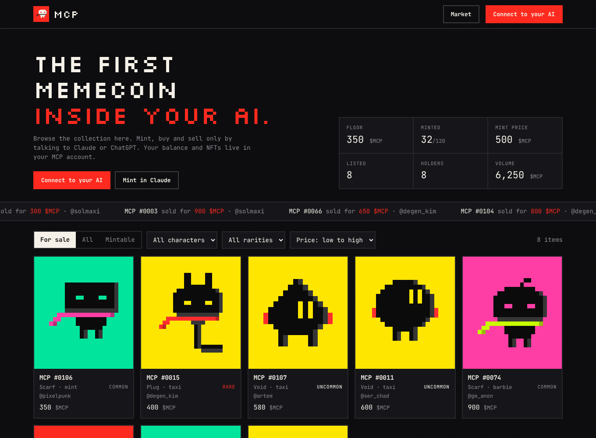

# $MCP: the first memecoin inside your AI


An NFT market that lives inside Claude and ChatGPT. You add one connector, sign in with X, and then just talk:
*"mint me an MCP"*, *"what's on the market under 500?"*, *"buy #0042"*, *"list my Scarf for 900"*, *"what's my balance?"*

The website only shows the collection, prices and owners. Every action happens in your AI chat.

This repository is the whole server, so you can read exactly what the connector does before you plug it in.

> **Status: public test.** Balances are free test $MCP from the faucet, and sign-in accepts any handle. Nothing here is real money yet.



## Connect

**Connector URL:** `https://mcp-market.netlify.app/mcp`

- **Claude:** Settings → Connectors → *Add custom connector* → paste the URL → *Connect* → sign in.
- **ChatGPT:** Settings → Apps & Connectors → add a connector with the same URL → sign in.

Then ask for `faucet` to get test $MCP and start trading.

## What the connector can and can't do

These are all the tools the server exposes ([`server/src/mcp.js`](server/src/mcp.js)):

| Tool | What it does | Changes anything? |
|---|---|---|
| `account` | your handle, balance, NFTs, recent balance changes | no |
| `deposit` | how to top up | no |
| `faucet` | free test $MCP once a day (test server only) | your balance |
| `mint` | random NFT from the collection for 500 $MCP, max 5 per account | your balance, NFT owner |
| `my_nfts`, `market`, `nft` | look around | no |
| `buy` | buy a listed NFT; needs the exact price you agreed to | your balance, NFT owner |
| `sell`, `cancel_listing` | list your NFT or take it off sale | listing |
| `set_withdraw_address` | bind a Solana address for withdrawals, **once** | your account |
| `withdraw` | send $MCP to that bound address only | your balance |

**It can't:**
- see your chats, files, other connectors or anything outside this market;
- post on X, read your DMs or follow anyone: the X login asks only for `users.read tweet.read`, to learn your handle and avatar;
- send money anywhere except the one withdrawal address you bound yourself. Changing it needs support, so a prompt-injected AI can't redirect your funds.

**What the server stores:** your X id, handle, name and avatar; your balance, NFTs and a ledger of every balance change. OAuth codes and tokens are kept only as sha256 hashes. See [SECURITY.md](SECURITY.md) for the full list of protections.

## How it works

```
Claude / ChatGPT ──MCP over HTTPS──▶ /mcp ─┐
Your browser ──sign in──▶ /authorize, /login ─┤  one serverless function (Express)  ──▶  Postgres (Supabase)
Preview site ──▶ /api/* ───────────────────────┘
NFT images, site ──▶ CDN (static)
```

- **No blockchain for NFTs.** They are images on this server plus an owner row in the database. The chain is only the way in and out: buy $MCP on a Solana DEX, deposit it, withdraw it back.
- **Every balance change** writes a ledger row in the same database transaction, so balances always add up. The tests check this.
- **Market fee:** 2.5% of each sale goes to the treasury.

```
server/src/
  app.js      HTTP routes: /mcp, OAuth, public API, deposit webhook
  mcp.js      the tools listed above
  market.js   rules: balances, mint, listings, buys, withdrawals
  auth.js     OAuth for the connector + X sign-in
  schema.js   database tables
  lambda.js   serverless entry (Netlify Functions)
  index.js    plain Node entry (npm start)
site/         the preview website
collection/   NFT images and traits
netlify/      Netlify function wrapper
```

## Run it locally

Node 22+.

```bash
npm install
cp .env.example .env      # test mode, embedded database, no setup needed
npm run demo              # optional: 8 fake traders so the site has something to show
npm start                 # http://localhost:3000, connector at http://localhost:3000/mcp
npm test                  # end-to-end tests: real OAuth, real MCP client, two users trading
```

## Deploy your own

1. **Database:** create a Supabase project. Copy *Connect → Transaction pooler* URI (port 6543). Tables are created on first start.
2. **Netlify:** import this repo. Build settings come from `netlify.toml`. Set the environment variables:

| Variable | Value |
|---|---|
| `PUBLIC_URL` | `https://<your-site>.netlify.app` |
| `DATABASE_URL` | the Supabase pooler URI |
| `TEST_MODE`, `DEV_LOGIN` | `1` for a test server; remove both for production |
| `X_CLIENT_ID`, `X_CLIENT_SECRET` | X app with OAuth 2.0, callback `PUBLIC_URL/login/x/callback` |
| `ADMIN_TOKEN` | long random secret for the deposit webhook; unset means the webhook is off |

3. Smoke-test it: `npm run smoke -- https://<your-site>.netlify.app`

## Roadmap

- [x] Market, mint, OAuth connector, preview site, test server
- [ ] Real X sign-in on the public server
- [ ] Deposits: personal Solana deposit addresses + Helius webhook → `/admin/deposit`
- [ ] Withdrawal worker (queued withdrawals are already recorded)
- [ ] Final collection

## Honest risks

- **Custodial.** Deposited tokens sit in the project's wallet, and the database is the source of truth for balances.
- **NFTs live on this server.** They exist as long as the server does.
- **Bots.** A server can't prove a request came from a human in Claude. Defenses: X sign-in, minimum account age, per-account mint limits.

## License

[MIT](LICENSE)
